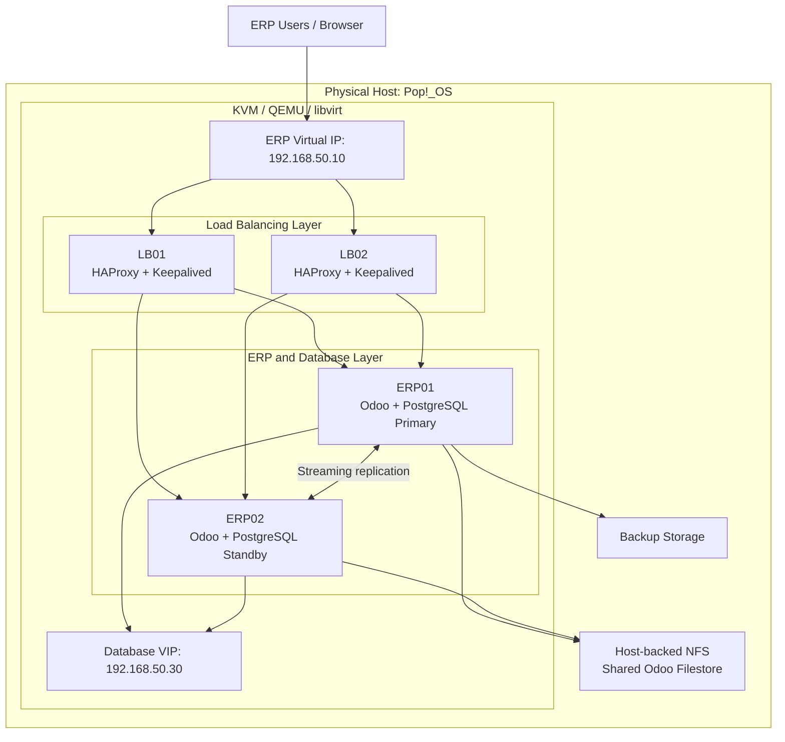

# HA ERP

Created: November 16, 2026 12:01 PM

```bash
ha-erp-infrastructure/
├── docs/
│   ├── requirements.md
│   ├── architecture.md
│   ├── network-design.md
│   ├── deployment-guide.md
│   ├── failover-tests.md
│   └── limitations.md
├── diagrams/
│   ├── logical-architecture.png
│   ├── physical-architecture.png
│   └── network-topology.png
├── ansible/
│   ├── inventory/
│   ├── playbooks/
│   └── roles/
├── configs/
│   ├── haproxy/
│   ├── keepalived/
│   └── postgresql/
├── monitoring/
│   └── prometheus/
├── tests/
│   ├── application-failure.sh
│   ├── load-balancer-failure.sh
│   └── database-failure.sh
├── evidence/
└── README.md
```

# **1. Architecture decisions**

| Decision | Selection |
| --- | --- |
| Hypervisor | KVM/QEMU + libvirt |
| Host OS | Pop!_OS |
| Guest OS | Debian 13 minimal |
| ERP | Odoo Community 17 |
| Application deployment | Docker Engine + Compose |
| Database | PostgreSQL 16 |
| Database HA | Streaming replication |
| Application load balancing | HAProxy |
| Load-balancer HA | Keepalived + VRRP |
| Database endpoint | Dedicated DB VIP |
| Shared files | NFS |
| Automation | Ansible |
| Monitoring | Prometheus + Grafana  |

# 2. Overall Architecture




# **4. Network architecture**

> A dedicated virtual network, isolated from the rest of the host's network.
> 

Proposed network:

- Network name: `ha-erp-net`
- Subnet: `192.168.50.0/24`
- Hypervisor: KVM/libvirt
- Network mode: NAT with an internal virtual bridge.
- Static IP addressing.

## **IP addressing plan**

| Component | Address | Purpose |
| --- | --- | --- |
| Host / bridge | 192.168.50.1 | Host access and NFS |
| ERP VIP | 192.168.50.10 | User-facing endpoint |
| LB01 | 192.168.50.11 | Load balancer |
| LB02 | 192.168.50.12 | Load balancer |
| ERP01 | 192.168.50.21 | Odoo + DB primary |
| ERP02 | 192.168.50.22 | Odoo + DB standby |
| DB VIP | 192.168.50.30 | Active PostgreSQL endpoint |

## **Communication flows**

| Source | Destination | Port | Purpose |
| --- | --- | --- | --- |
| Users | ERP VIP | 80/443 | ERP access |
| LB nodes | ERP nodes | 8069 | Odoo HTTP |
| ERP nodes | DB VIP | 5432 | PostgreSQL |
| ERP01 | ERP02 | 5432 | Replication |
| ERP nodes | Host NFS | 2049 | Shared filestore |
| Admin | All VMs | 22 | SSH administration |

# **5. Application availability design**

The user accesses the ERP through a single address:

`http://192.168.50.10`

<u>The address belongs to the active load balancer.</u>

### **HAProxy responsibilities**

> LB01 and LB02 will have identical HAProxy configurations.
> 

HAProxy distributes requests between:

- ERP01: `192.168.50.21:8069`
- ERP02: `192.168.50.22:8069`

Configuration:

- HTTP health checks.
- Backend failure detection.
- Cookie-based session persistence.
- Automatic removal of unhealthy nodes.
- Automatic reintroduction after recovery.

### **Keepalived responsibilities**

Keepalived manages the floating ERP VIP.

Normal state:

```
192.168.50.10
       |
       v
     LB01
    MASTER

     LB02
    BACKUP
```

After LB01 failure:

```
192.168.50.10
       |
       v
     LB02
    MASTER
```

---

# 6. Database availability


### **Normal operation**

1. ERP01 accepts database writes.
2. PostgreSQL streams WAL records to ERP02.
3. ERP02 continuously replays those records.
4. Both Odoo instances connect to the active database through the DB VIP.

### **Failure scenario**

Suppose ERP01 becomes unavailable.

1. Detect that the primary database is unavailable.
2. Confirm the old primary is stopped or fenced.
3. Promote ERP02 using PostgreSQL standby promotion.
4. Move the DB VIP to ERP02.
5. Re-establish Odoo database connections.
6. Verify that transactions and application functionality work.

---

# **7. Shared storage and persistence**

Odoo uses both:

- PostgreSQL for structured application data.
- Its filestore for uploaded documents and attachments.

If ERP01 and ERP02 use separate filestores, an attachment uploaded through ERP01 might not be available through ERP02.

```
Pop!_OS Host
     |
     +-- /srv/ha-erp/filestore
               |
          NFS Export
               |
       +-------+-------+
       |               |
     ERP01            ERP02
       |               |
     Odoo             Odoo
       |               |
       +-------+-------+
               |
       Shared Filestore
```

Both ERP nodes mount the same NFS export.

We'll also create scheduled backups containing:

- PostgreSQL database backups.
- Odoo filestore backups.
- Configuration files.
- Infrastructure configuration.

The host-backed NFS server remains a single point of failure. It is acceptable for this constrained laboratory, but it must be listed as a limitation.

# **8. Security architecture**

Let's avoid building an HA system that is available to attackers as efficiently as it is available to users.

Baseline controls:

| Area | Security measure |
| --- | --- |
| Virtual networking | Isolated libvirt network |
| Administration | SSH keys |
| Firewall | Restrictive inbound rules |
| ERP exposure | Only through the load balancer |
| Database | No direct user access |
| PostgreSQL | Restricted replication account |
| NFS | Restricted export to ERP nodes |
| Secrets | Ansible Vault |
| Containers | Dedicated non-root execution where supported |
| Backups | Restricted access and integrity checks |