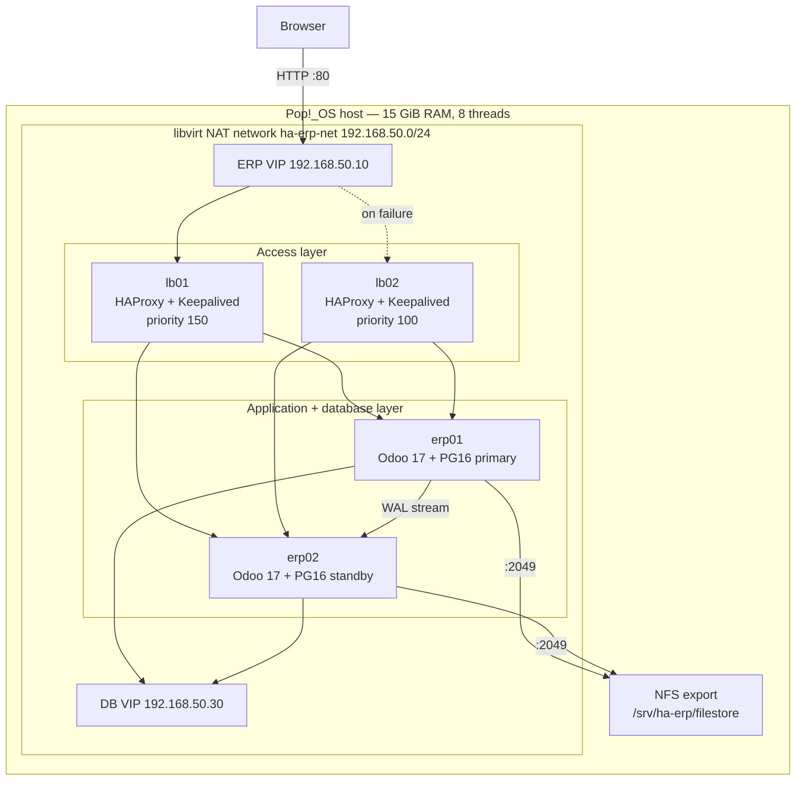

# Architecture

> Structured version of the design. Supersedes the scratch notes in [`../architecture.md`](../architecture.md),
> which is kept as the original brief.

## 1. Design in one paragraph

Four Debian 13 VMs run on one libvirt host. Two of them (`lb01`, `lb02`) are interchangeable HTTP
entry points behind a Keepalived-managed virtual IP. The other two (`erp01`, `erp02`) each run an
Odoo 17 container backed by a native PostgreSQL 16 instance; `erp01` is the primary, `erp02` streams
WAL from it. Both Odoo instances connect to PostgreSQL through a second virtual IP that is owned by
whichever node currently holds the primary role. Both mount the same NFS export from the hypervisor
for the Odoo filestore, so attachments and sessions are shared. Ansible builds every layer; shell
harnesses inject failures and record timings.

## 2. Layers and responsibility

| Layer | Component | Responsibility | Redundancy mechanism |
|-------|-----------|----------------|----------------------|
| Access | HAProxy on lb01/lb02 | HTTP distribution, health checks, sticky sessions, stats | Active/backup pair behind `ERP_VIP` |
| Access | Keepalived on lb01/lb02 | Owns `192.168.50.10`, fails over in ~3 s | VRRP unicast, priorities 150/100, `chk_haproxy` |
| Application | Odoo 17 container on erp01/erp02 | Serve ERP, mount NFS filestore, talk to DB VIP | Two identical instances, HAProxy pool |
| Database | PostgreSQL 16 on erp01/erp02 | ERP data, WAL streaming | Async streaming replication + controlled promotion |
| Database endpoint | Keepalived on erp01/erp02 | Owns `192.168.50.30` and follows the primary role | Role file + binary-mode `vrrp_script` (ADR-006) |
| Storage | NFS server on the host | Shared filestore `/srv/ha-erp/filestore` | None (documented SPOF) |
| Automation | Ansible | Idempotent provisioning | Roles + templates, vault for secrets |

## 3. Logical architecture

## 4. Request and data paths

### 4.1 User request

1. Browser resolves `erp.ha-erp.lab` (or uses the IP directly) to `192.168.50.10`.
2. The LB currently holding the VIP receives the request on port 80.
3. HAProxy picks a backend server in `UP` state, honouring the `SERVERID` cookie if present, and
   adds `X-Forwarded-For`, `X-Forwarded-Proto` and `X-LB` (the LB hostname, used as test evidence).
4. The chosen Odoo instance serves the request. Sessions live in the shared filestore, so a cookie
   that points to a now-dead server can be redispatched (`option redispatch`) without losing login.
5. Odoo queries PostgreSQL at `192.168.50.30:5432`, which resolves to the primary's address via the
   DB VIP.

### 4.2 Database writes

Odoo on either node → DB VIP → primary PostgreSQL → WAL → `wal sender` → standby `wal receiver` →
replay. Asynchronous: `synchronous_standby_names` is deliberately empty (ADR-007 context).

### 4.3 Attachment upload

Odoo writes the binary to `<data_dir>/filestore/<db>/...` on the NFS mount and the metadata row to
PostgreSQL. Because both containers bind-mount the same export, the second instance sees the file
immediately; the database row (replicated asynchronously) is the only consistency window.

### 4.4 Session state

Odoo stores HTTP sessions under `<data_dir>/sessions`. Sharing the filestore means a session created
on erp01 is valid on erp02, which is what makes active/active without a shared session store viable.
Sticky cookies remain enabled to keep per-user caches warm and to make the demonstration legible.

## 5. Failure domains and blast radius

| Failure | Impact | Survives? | Recovery |
|---------|--------|-----------|----------|
| Odoo process/container on one node | ~half of capacity lost | Yes — HAProxy drains in ≤ 4 s | `systemctl start ha-erp-odoo` |
| Whole erp01 VM (app + DB primary) | Half capacity, **database writes stop** | Reads: no (Odoo needs the DB); access layer: yes | Controlled promotion (T06/T07) |
| lb01 VM | VIP moves | Yes, ≤ 5 s | `virsh start lb01`, Keepalived returns as BACKUP |
| PostgreSQL on primary only | Writes stop, HAProxy health checks fail on both nodes because `/web/login` needs the DB | No | Promotion |
| NFS server on host | Both Odoo instances lose filestore | No | Restore export, restart containers |
| Host power loss | Everything | No | Rebuild from Ansible |

The combined app+DB failure domain on each ERP node is a deliberate trade-off (ADR-002). The report
must state that `erp01` failing removes both an application instance and the write master.

## 6. State ownership

| State | Authoritative copy | Replica | Consistency |
|-------|--------------------|---------|-------------|
| ERP relational data | primary PostgreSQL data dir | standby data dir (WAL) | asynchronous, lag measured |
| Attachments / sessions | NFS export on host | none | single copy, shared |
| Odoo configuration | `/opt/ha-erp/odoo` on each node | Ansible templates | identical by construction |
| HAProxy / Keepalived config | each node, rendered by Ansible | — | identical per role |
| Secrets | Ansible Vault | rendered at deploy time | never in Git |
| VIP ownership | VRRP state machine | — | one owner at a time |
| DB role | `/etc/ha-erp/db-role` | — | explicit operator action |

## 7. Startup and shutdown order

Startup: `ha-erp-net` → ERP nodes (PostgreSQL, then Odoo, then Keepalived) → LB nodes (HAProxy, then
Keepalived). Shutdown is the reverse. The Ansible `site.yml` enforces this with plays; the VM
autostart flag is only enabled for the ERP nodes so the database is available before health checks
begin.

## 8. Resource budget (from ADR-002)

| Consumer | vCPU | RAM | Disk |
|----------|------|-----|------|
| lb01 + lb02 | 2 | 1 GiB | 12 GB thin |
| erp01 + erp02 | 4 | 4 GiB | 24 GB thin |
| host (libvirt, NFS, Ansible) | — | ~3 GiB resident | ~5 GB |
| **Total guests** | **6 of 8** | **5 GiB of 6.1 GiB available** | **36 GB of 53 GB free** |

Odoo: `workers = 2`, `max_cron_threads = 1`, `limit_memory_soft = 1.2 GB`. PostgreSQL:
`shared_buffers = 192 MB`, `effective_cache_size = 512 MB`, `work_mem = 4 MB`,
`max_connections = 100`, `wal_keep_size = 512 MB`.

## 9. Explicit non-goals

Automatic database failover, quorum/fencing service, synchronous replication, multi-host
virtualization, redundant NFS, TLS PKI, centralized logging, and production capacity planning.
Monitoring beyond HAProxy stats + `verify.yml` is optional and deferred.
